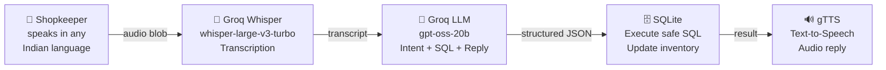

# VoxMetrics 🎙️

**Multilingual Voice Copilot for Indian Kirana Stores**

A voice-first inventory management assistant that lets small Indian shopkeepers manage stock, process sales, and query analytics by speaking naturally in **Hindi, Tamil, Marathi, Bengali, Telugu, Hinglish**, or **English**.

> _"10 packet mattha add karo"_ → ✅ Added 10 packets of Curd. New stock: 70 packets.

---

## 🎯 Problem Statement

India has **12 million+ Kirana (grocery) stores**, most run by owners who:
- Track stock mentally or in handwritten registers
- Are more comfortable speaking than typing
- Speak regional languages and code-switch between them
- Need quick profit/loss insights without spreadsheet literacy

**VoxMetrics** bridges this gap with a **voice-first, multilingual copilot** that turns spoken commands into real inventory operations — in the shopkeeper's own language.

---

## 🏗️ Architecture — 4-Step Voice Pipeline



| Step | Component | Purpose |
|------|-----------|---------|
| **1. Listen** | Groq `whisper-large-v3-turbo` | Transcribes multilingual audio with Kirana-context prompting |
| **2. Think** | Groq `gpt-oss-20b` | Detects language, extracts intent, generates safe SQL, writes a local-language reply |
| **3. Act** | SQLite + authorizer | Executes sandboxed SQL (ADD / SELL / ANALYTICS) with injection protection |
| **4. Speak** | gTTS | Converts the reply to speech in the detected language and streams it back |

---

## 🛠️ Tech Stack

| Layer | Technology |
|-------|------------|
| **Backend** | [FastAPI](https://fastapi.tiangolo.com/) (Python) |
| **Database** | SQLite (zero-config, file-based) |
| **Speech-to-Text** | [Groq Whisper](https://console.groq.com/) (`whisper-large-v3-turbo`) |
| **LLM** | [Groq](https://console.groq.com/) (`openai/gpt-oss-20b`) |
| **Text-to-Speech** | [gTTS](https://github.com/pndurette/gTTS) (Google TTS) |
| **Frontend** | Vanilla HTML/CSS/JS + [Chart.js](https://www.chartjs.org/) |
| **Charts** | Chart.js via CDN (bar charts for profit analytics) |

---

## 🚀 Local Setup

### Prerequisites
- Python 3.10+
- A [Groq API key](https://console.groq.com/keys) (free tier works)

### Steps

```bash
# 1. Clone the repository
git clone https://github.com/your-username/VoxMetrics.git
cd VoxMetrics

# 2. Create virtual environment
python -m venv venv
venv\Scripts\activate        # Windows
# source venv/bin/activate   # macOS / Linux

# 3. Install dependencies
pip install -r requirements.txt

# 4. Set your Groq API key
copy .env.example .env
# Edit .env and add: GROQ_API_KEY=gsk_your_key_here

# 5. Run the server
uvicorn main:app --reload --host 0.0.0.0 --port 8000

# 6. Open in browser
# http://localhost:8000
```

### File Structure

```
VoxMetrics/
├── main.py              # FastAPI server: endpoints, AI pipeline, TTS
├── database.py          # SQLite schema, seed data, read helpers
├── requirements.txt     # Python dependencies
├── .env                 # GROQ_API_KEY (not committed)
├── .env.example         # Template for .env
├── voxmetrics.db        # SQLite database (auto-created)
├── README.md            # This file
└── static/
    ├── index.html       # Main UI page
    ├── style.css        # Khatabook/Vyapar-style design system
    └── app.js           # Frontend logic, mic recording, audio playback
```

---

## 🗣️ Sample Voice Commands

### Hindi / Hinglish
| Speak this | What happens |
|------------|-------------|
| _"10 packet mattha add karo"_ | Adds 10 packets of curd to inventory |
| _"5 kilo cheeni bech do"_ | Sells 5 kg of sugar, reduces stock |
| _"Sabse zyada profit wala item kya hai?"_ | Shows the highest-profit item |
| _"Kitna doodh bacha hai?"_ | Queries remaining milk stock |
| _"50 gram namak add karo"_ | Adds 0.05 kg of salt (auto-converts grams) |

### Tamil
| Speak this | What happens |
|------------|-------------|
| _"5 packet thayir add pannunga"_ | Adds 5 packets of curd |
| _"Innaki highest profit entha item?"_ | Returns the top-profit item |
| _"2 litre paal add pannunga"_ | Adds 2 L of milk |
| _"Arisi stock eppadi irukku?"_ | Queries rice stock |

### Bengali
| Speak this | What happens |
|------------|-------------|
| _"10 packet doi add koro"_ | Adds 10 packets of curd |
| _"Kato chini ache?"_ | Queries sugar stock |

### English
| Speak this | What happens |
|------------|-------------|
| _"Add 5 kg sugar"_ | Adds 5 kg of sugar |
| _"Sell 2 litres of oil"_ | Sells 2 L of oil |
| _"Which item has the highest profit?"_ | Analytics query |

---

## 📡 API Reference

### `GET /api/inventory`
Returns the current inventory as JSON.

### `POST /api/process-command`
Text-based command processing.
```json
// Request
{ "transcript": "10 packet mattha add karo" }

// Response
{
  "intent": "ADD_INVENTORY",
  "detected_lang": "hi",
  "reply_local": "10 पैकेट दही जोड़ दिया गया। नया स्टॉक: 70 पैकेट।",
  "chart_data": null,
  "inventory": [...],
  "audio_base64": "//uQxAAA..."
}
```

### `POST /api/voice-command`
Voice command processing via audio upload (multipart/form-data).
```json
// Response
{
  "transcript": "10 packet mattha add karo",
  "intent": "ADD_INVENTORY",
  "detected_lang": "hi",
  "reply_local": "10 पैकेट दही जोड़ दिया गया। नया स्टॉक: 70 पैकेट।",
  "chart_data": null,
  "inventory": [...],
  "audio_base64": "//uQxAAA..."
}
```

---

## 🔒 Safety Features

- **SQL Authorizer**: SQLite authorizer callback restricts queries to only the `inventory` table with allowed columns — `DROP`, `DELETE`, `ALTER`, `INSERT`, `TRUNCATE` are all blocked.
- **Pydantic Validation**: Every LLM response is validated against strict schemas before execution.
- **Regex Guards**: UPDATE queries are verified via regex to ensure they match the expected pattern exactly.
- **Sell Protection**: SELL operations check `quantity >= amount` before executing to prevent negative stock.
- **TTS Fallback Chain**: `lang → hi → en` — TTS never crashes the endpoint, just returns empty audio.

---

## 📄 License

MIT — Built for hackathons and Kirana stores everywhere.
